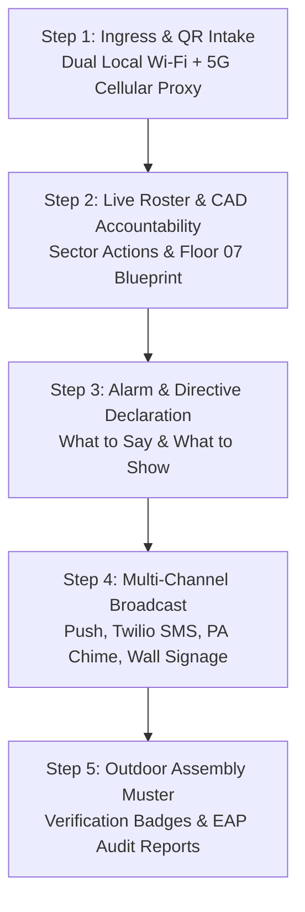

# FSD Remix Console — 5-Step Life-Safety Emergency & Evacuation Command System

A mission-critical Fire Safety Director (FSD) and Emergency Action Plan (EAP) incident command console engineered for enterprise high-rises and commercial headquarters. Compliant with **NYC Fire Code 3 RCNY §401-06**, NFPA standards, and Con Edison critical infrastructure life-safety guidelines.

---

## 🌟 Overview & Core Lifecycle

The console unifies building occupant accountability, floor warden radio communication, and automated life-safety directives into a resilient 5-step operational workflow:



---

## 🚀 The 5-Step Command Pipeline

### Step 01: Ingress & QR Intake System
- **Dual Network QR Posters**: Generates high-resolution vector QR codes with instant toggling between internal facility Wi-Fi and permanent **5G Cellular Public Proxy**.
- **Intake Modals & Camera Scanner**: Built-in webcam/mobile camera QR badge scanner, self-intake form, and batch roster ingestion.
- **Auto-Routing**: First-time arrivals are directed to the fast sign-in form; returning personnel are instantly routed to their active mobile pass and Floor 07 egress route.

### Step 02: Real-Time Roster & Spatial Accountability
- **Interactive Floor 07 CAD Map**: Visualizes occupants by quadrant (`NW`, `NE`, `SW`, `SE`) with exact workstation desk coordinates and status indicators (`Inside Building`, `Safe Outside`, `Needs Assistance`, `Badged Out`).
- **Occupant Action & Building Location Modal**: Click any occupant to inspect their building position on a floor blueprint and trigger targeted actions:
  - Mark Safe Outside
  - Confirm In-Building
  - Badge Out
  - Assign Stairwell A Evac Chair
  - Direct Priority Evac Ping
  - 1-Click Phone Call to Registered Mobile
- **Sector Group Actions**: Bulk-update entire floor sectors (e.g., mark all NW occupants safe) in a single click.

### Step 03: Emergency Alarm & Directive Protocol
- **Hazard Scenarios**: Fast selection for Office Fire, Gas Leak, Active Threat, Power Failure, Structural Hazard, or Scheduled Drill.
- **What to Say (PA & Radio Script)**: Auto-generated, standardized spoken script conforming to NYC Fire Code 3 RCNY §401-06, featuring:
  - 1-Click Audio Playback Preview using natural AI voice cadence and acoustic PA chime.
  - One-click copy for handheld radio dispatch.
- **What to Show (Mobile Pass & Wall Signage)**: Live visual simulation of what occupants and hallway screens display: designated stairwell, locked elevator warnings, and external muster zones.

### Step 04: Multi-Channel Emergency Dispatch & Radio
- **Multi-Channel Push**: Simultaneous dispatch to Web Push notifications, Twilio SMS gateways, building PA audio speakers, and hallway digital signage.
- **Warden Walkie-Talkie Station (PTT)**: Push-to-Talk voice transmission with acoustic radio effects and real-time speech-to-text transcription.
- **Dynamic Audience Sync**: Instant dispatch receipts and delivery confirmations for all registered personnel.

### Step 05: External Muster & Verification Audit
- **Outdoor Assembly Verification**: Digital badge scanning at Assembly Points (Park Plaza, Irving Pl, 15th St).
- **Compliance Export**: 1-click audit-grade export for FDNY, building management, and insurance life-safety records.

---

## 🛠️ Tech Stack & Architecture

- **Frontend**: React 19, TypeScript 5.8, Tailwind CSS v4, Lucide Icons, Motion.
- **Backend**: Node.js, Express, ESBuild, TSX, WebSocket / Server-Sent Events.
- **Database & Sync**: Hybrid persistence architecture utilizing IndexedDB for instantaneous local failover and Firebase Firestore / PostgreSQL for centralized real-time sync.
- **Audio & Speech**: Web Speech API with custom audio synthesis, commercial PA chimes, and industrial radio noise filter.
- **QR Engine**: `qrcode`, `jsqr` with vector canvas rendering and camera decoding.

---

## 💻 Getting Started

### Prerequisites
- Node.js 20+
- npm or bun

### Installation
```bash
git clone https://github.com/SamMcfarlane-pursuit/fsd-remix-console.git
cd fsd-remix-console
npm install
```

### Development
```bash
npm run dev
```
The server will start at `http://localhost:3000`.

### Type-Check & Build
```bash
# Type-check
npm run lint

# Production build (Vite + Node Server bundle)
npm run build

# Start production server
npm start
```

---

## 📄 License & Compliance

Compliant with **NYC Fire Code 3 RCNY §401-06**, NFPA 72 National Fire Alarm and Signaling Code, and enterprise high-rise emergency action planning standards.
